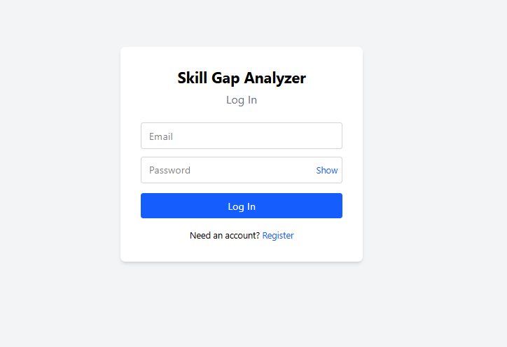
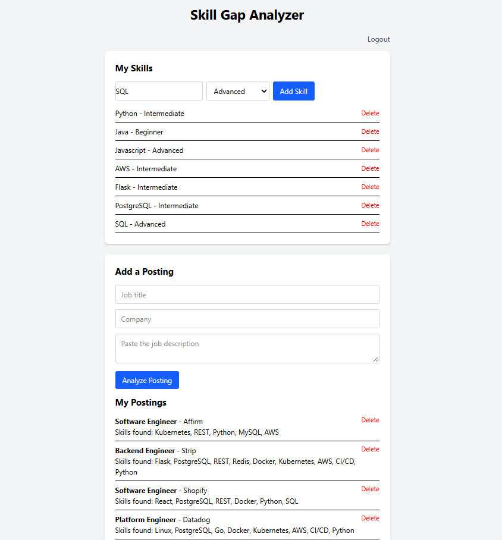
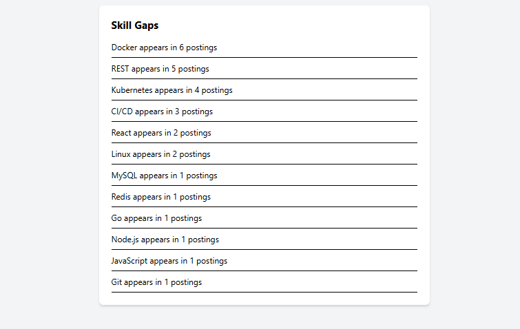

# Skill Gap Analyzer


### Live Demo
https://skill-gap-analyzer-1-6rwr.onrender.com/

Try the app with **demo@example.com** / **DemoPass123**

> Note: the backend is hosted on a free tier that spins down when idle, so the
> first request after a period of inactivity may take 30–60 seconds to wake up.

## Overview
The Skill Gap Analyzer is a full-stack web application that helps job seekers
see how their skills stack up against the jobs they want.

A user builds a profile of their skills, then pastes in job descriptions. The
app extracts the skills each posting requires, scores how well the user matches,
and — across every posting they've saved — surfaces the skills that come up most
often but are missing from their profile. It answers a concrete question: *which
skill should I learn next to become a stronger candidate?*

Users can add skills with a proficiency level (Beginner, Intermediate,
Advanced), submit and analyze job postings, view the skills extracted from each
posting, and see an aggregated breakdown of their biggest skill gaps.

## Screenshots

### Login


### Skills and Postings


### Skill Gaps


## Architecture

The application is split into two independently deployed services that
communicate over HTTPS with a JSON REST API.

┌─────────────────────────┐ ┌─────────────────────────┐
│ React frontend │ │ Flask backend │
│ (Vite, Tailwind) │──JSON──▶│ REST API │
│ Render static site │◀───────│ Render web service │
└─────────────────────────┘ └───────────┬─────────────┘
│
┌───────────▼─────────────┐
│ PostgreSQL │
│ Render managed DB │
└─────────────────────────┘


- The **frontend** is a React single-page app. It holds UI state, calls the API
  with `fetch`, and never talks to the database directly.
- The **backend** is a Flask API using an application factory and blueprints. It
  handles authentication, owns all data access, and runs the skill-extraction and
  scoring logic.
- **Authentication** uses server-side sessions stored in a signed cookie. Because
  the frontend and backend live on different origins, the backend is configured
  with CORS and cross-site (`SameSite=None; Secure`) session cookies.
- The **skill-extraction engine** is a standalone, dependency-free Python module
  that matches job-description text against a curated skill dictionary using
  word-boundary regex, alias resolution, and longest-match-first ordering.

## Tech Stack
- Python
- Flask
- JavaScript
- React (Vite)
- Tailwind CSS
- PostgreSQL
- psycopg2
- Gunicorn
- Git and GitHub
- Deployed on Render
- REST API (JSON)
- Flask Blueprints
- Flask-Migrate (Alembic)
- Werkzeug password hashing
- Flask sessions
- flask-cors
- pytest

## Features
- User registration and login with hashed passwords and session-based auth
- Per-user data isolation — users only see their own skills and postings
- Add skills with a proficiency level, and remove them
- Submit a job description and automatically extract the skills it mentions
- Skill extraction handles aliases ("JS" → "JavaScript"), whole-word matching
  ("Java" does not match inside "JavaScript"), punctuation ("C++"), and
  multi-word skills ("React Native")
- Match scoring: for each posting, see which required skills you have and which
  you're missing, with an overall match percentage
- Skill-gap dashboard: across all saved postings, see the missing skills that
  appear most often
- Show/hide password toggle
- Responsive UI styled with Tailwind

## API Endpoints

All `/api/*` endpoints require authentication. Unauthenticated requests return
401 with a JSON error body. Requests for records that don't exist return 404,
and validation errors return 400 with a descriptive message.

| Method | Endpoint | Description |
|--------|----------|-------------|
| POST | `/register` | Create an account and log in |
| POST | `/login` | Log in |
| POST | `/logout` | Log out |
| GET | `/api/me` | Return the current user, or 401 if not logged in |
| GET | `/api/skills` | List the user's skills |
| POST | `/api/skills` | Add a skill |
| GET | `/api/skills/<id>` | Retrieve a single skill |
| DELETE | `/api/skills/<id>` | Delete a skill |
| GET | `/api/postings` | List the user's postings with extracted skills |
| POST | `/api/postings` | Submit a description; extract and store its skills |
| GET | `/api/postings/<id>` | One posting with its skills and match score |
| DELETE | `/api/postings/<id>` | Delete a posting |
| GET | `/api/gaps` | Aggregated most-frequently-missing skills |

## Local Setup

The project has two parts: a Flask backend at the repo root and a React frontend
in `frontend/`. You'll run both.

### Backend

Clone the repository and enter it:

```bash
git clone https://github.com/DeviWilk3747/skill-gap-analyzer.git
cd skill-gap-analyzer
```

Create and activate a virtual environment:

```bash
python3 -m venv .venv
source .venv/bin/activate        # macOS/Linux
.venv\Scripts\Activate.ps1       # Windows PowerShell
```

Install dependencies:

```bash
pip install -r requirements.txt
```

Create a PostgreSQL database:

```bash
createdb skill_gap
```

Create a `.env` file in the project root:

```text
SECRET_KEY=your-secret-key
DATABASE_URL=postgresql://youruser@localhost:5432/skill_gap
```

Generate a secret key with:

```bash
python -c "import secrets; print(secrets.token_hex(32))"
```

Apply the migrations and start the server:

```bash
flask db upgrade
python run.py
```

The backend runs on `http://localhost:5000`.

### Frontend

In a second terminal:

```bash
cd frontend
npm install
```

Create `frontend/.env`:

```text
VITE_API_URL=http://localhost:5000
```

Start the dev server:

```bash
npm run dev
```

The frontend runs on `http://localhost:5173`.

## Running the Tests

The backend has a pytest suite covering the extraction engine, authentication,
input validation, scoring, and cross-user data isolation.

Create a test database:

```bash
createdb skill_gap_test
```

Add its connection string to `.env`:

```text
TEST_DATABASE_URL=postgresql://youruser@localhost:5432/skill_gap_test
```

Run the suite from the project root:

```bash
python -m pytest
```

## What I Learned
- How to build and deploy a full-stack application as two independent services
- How a React frontend communicates with a separate API over JSON
- React fundamentals: components, props, state (`useState`), side effects
  (`useEffect`), controlled inputs, and conditional rendering
- How to design a text-processing engine and cover its edge cases with tests
- How to keep the frontend/backend API contract consistent across endpoints
- How session-based authentication works across different origins, including
  CORS and cross-site cookie configuration
- How to keep secrets and environment-specific config out of source control
- Why deployment surfaces problems that never appear locally (cross-origin
  cookies, environment variables at build time vs runtime, database URL formats)